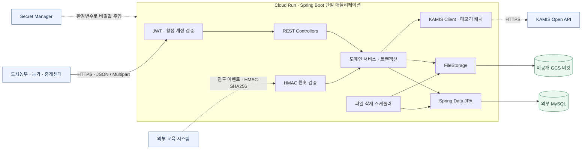
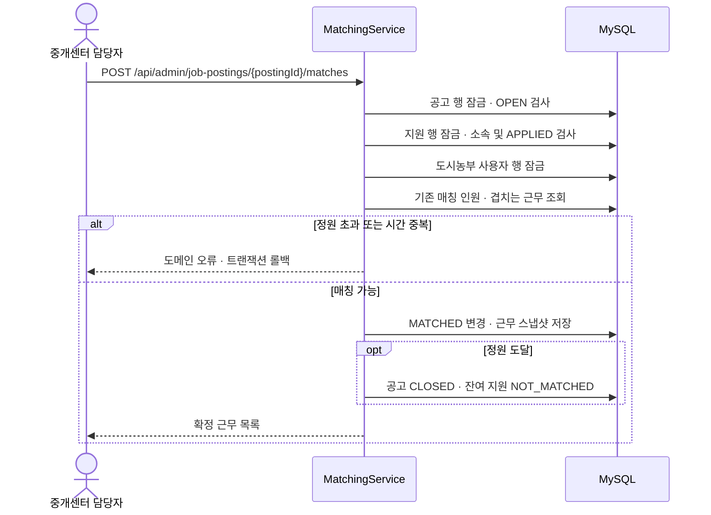
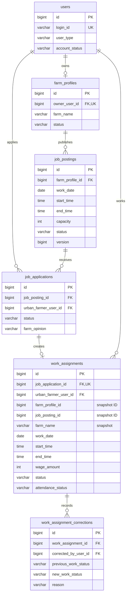
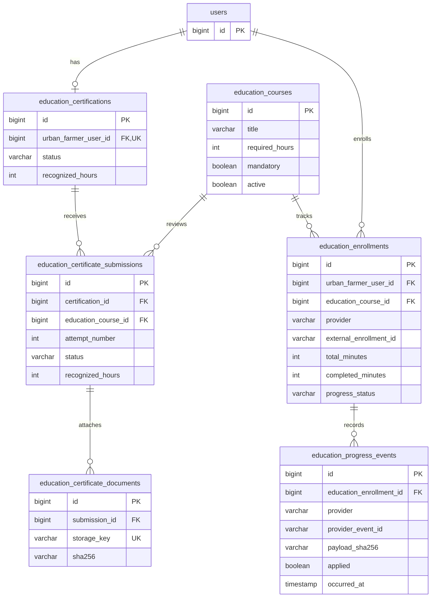
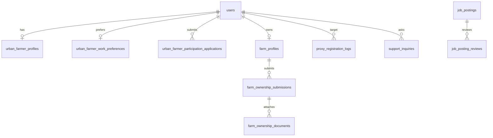
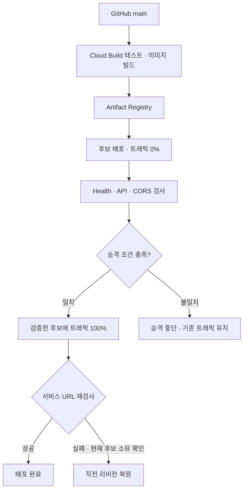

# 도시농부플러스 | CityFarmerPlus Backend

> 도시농부의 교육·지원부터 농가 모집, 중개센터 심사·매칭, 출결 관리까지 연결하는 Spring Boot 백엔드

`Java 17` · `Spring Boot 4.1.0` · `Spring Security` · `JPA` · `MySQL` · `Cloud Run`

> 도시농부플러스 서비스 로고 사진

도시농부플러스는 충북형 도시농부 사업의 참여자와 농가, 중개센터가 같은 신청·심사·근무 정보를 확인할 수 있도록 만든 프로젝트입니다. 이 저장소는 세 사용자 유형의 REST API와 데이터 모델, 파일 저장, 외부 연동, 배포 구성을 포함합니다.

백엔드에서는 **누가 상태를 변경할 수 있는지, 동시에 처리해도 데이터가 유효한지, 외부 시스템이 실패했을 때 어떻게 복구하는지**를 중심으로 구현했습니다.

[핵심 설계](#핵심-설계와-문제-해결) · [아키텍처](#백엔드-아키텍처) · [ERD](#데이터-모델과-erd) · [테스트](#테스트와-검증) · [실행 방법](#로컬-실행) · [API 명세](docs/API_SPEC_INDEX.md)

## 백엔드 구현 범위

| 영역 | 구현 내용 |
|---|---|
| 인증·인가 | BCrypt 비밀번호 암호화, JWT 인증, 역할·소유권 검증, 탈퇴 계정의 기존 토큰 차단 |
| 도시농부 | 프로필·근무 선호·연도별 참여 신청 통합 저장, 교육 이수증 제출, 공고 지원·취소 |
| 농가 | 농가 프로필·소유 증빙 제출, 공고 초안·심사 요청, 지원자 의견, 출결·근무 완료 |
| 중개센터 | 참여·교육·농가·공고 심사, 최종 매칭, 출결 정정, 대리 접수와 감사 이력, 운영 집계 |
| 데이터 정합성 | 비관적 잠금, 버전 검사, UNIQUE 제약, 근무 조건 스냅샷, 상태 전이 검증 |
| 파일·외부 연동 | Local/GCS/S3 저장소 전환, 삭제 재시도, 교육 진도 웹훅, KAMIS 시세 캐시 |
| 운영 | Docker 이미지, Cloud Build 배포 절차, 후보 리비전 검사, 트래픽 전환·롤백, DB 마이그레이션 스크립트 |

농가는 지원자의 선호·비선호 의견을 남기고, 최종 매칭은 `CENTER_ADMIN`이 확정합니다. 공고의 임금은 근로조건 정보이며 결제·송금·정산은 구현 범위에 포함하지 않습니다. 알림함·푸시·문자도 현재 범위에서 제외했습니다.

## 백엔드 아키텍처

도메인별 패키지로 나눈 단일 Spring Boot 애플리케이션입니다. Controller가 요청과 인증 정보를 받고, Service가 트랜잭션·권한·업무 흐름을 조합하며, Entity와 정책 클래스가 상태 전이 조건을 검증합니다. 영속성은 Spring Data JPA로 처리합니다.

아래는 저장소의 코드와 배포 설정을 기준으로 작성한 구성도입니다. 외부 교육 시스템은 웹훅 수신 계약을 표현하며, 특정 LMS의 실제 연결 여부를 의미하지 않습니다.



- 배포 스크립트는 **외부 MySQL과 GCS**를 사용합니다. Cloud SQL은 기본 배포 구성에 포함하지 않습니다.
- `FileStorage` 인터페이스에 Local, GCS, S3 호환 구현체를 두고 설정으로 선택합니다. 세 저장소를 동시에 사용하는 구조는 아닙니다.
- `spring.jpa.open-in-view=false`로 설정하고 서비스 계층에서 응답 DTO를 구성합니다.
- KAMIS 캐시는 애플리케이션 인스턴스의 메모리에 유지합니다.

기술 선택과 설정은 [build.gradle](build.gradle), [application.properties](src/main/resources/application.properties), [FileStorageConfig](src/main/java/chungbuk/cityfarmerplus/common/storage/FileStorageConfig.java), [배포 가이드](docs/GCP_DEPLOYMENT.md)에서 확인할 수 있습니다.

## 핵심 설계와 문제 해결

### 1. 정원 초과와 같은 시간대 중복 매칭 방지

담당자가 같은 공고를 동시에 매칭하면 두 요청이 모두 남은 정원을 확인한 뒤 인원을 초과해 배정할 수 있습니다. 서로 다른 공고를 처리하더라도 동일한 도시농부를 겹치는 시간에 배정하는 문제가 생깁니다.

`AdminJobPostingMatchingService.match()`는 하나의 트랜잭션에서 다음 순서로 처리합니다.

1. 공고를 `PESSIMISTIC_WRITE`로 조회하고 모집 중인지 확인합니다.
2. 요청된 지원 행을 잠그고 공고 소속·지원 상태·중복 ID를 검사합니다.
3. 대상 도시농부의 **사용자 행을 잠근 뒤** 기존 매칭 인원과 시간 중복을 조회합니다.
4. 조건을 만족하면 지원 상태 변경과 근무 배정 생성을 함께 저장합니다.
5. 정원에 도달하면 공고를 마감하고 남은 지원을 미선정으로 변경합니다.

사용자 행 잠금은 아직 근무 배정이 없는 경우에도 공통 잠금 대상을 제공합니다. 공고가 달라도 같은 도시농부를 매칭하는 요청은 해당 행에서 순서를 기다립니다. 여러 지원·사용자 행을 조회하는 잠금 쿼리는 ID 순으로 정렬합니다.



시간 중복은 같은 날짜에서 `기존 시작 < 신규 종료 AND 기존 종료 > 신규 시작`으로 판정합니다. 앞 근무의 종료와 다음 근무의 시작이 같은 경우는 허용합니다. DB에는 `(job_posting_id, urban_farmer_user_id)`와 `work_assignments.job_application_id`의 UNIQUE 제약도 둡니다.

**검증:** 잠금 순서와 겹치는 근무의 거부를 테스트합니다. 이 검증은 서비스 호출 순서와 저장소 계약에 관한 것이며, 실제 MySQL에서 병렬 트랜잭션을 반복한 부하 테스트 결과는 별도로 측정해야 합니다.

[매칭 서비스](src/main/java/chungbuk/cityfarmerplus/admin/jobposting/service/AdminJobPostingMatchingService.java) · [시간 중복 쿼리](src/main/java/chungbuk/cityfarmerplus/work/repository/WorkAssignmentRepository.java) · [잠금 순서 테스트](src/test/java/chungbuk/cityfarmerplus/admin/jobposting/service/AdminJobPostingMatchingServiceLockTest.java)

### 2. 여러 입력을 원자적으로 저장하고 확정 이력 보존

도시농부의 참여 신청은 프로필, 근무 선호, 연도별 신청서에 걸쳐 있습니다. 일부만 저장되거나 이전 화면의 입력으로 최신 내용을 덮어쓰지 않도록 통합 저장 API를 구성했습니다.

`ParticipationFormService`는 사용자 → 신청서 → 프로필 → 근무 선호 순서로 잠금을 획득하고, 요청의 `expectedApplicationVersion`, `expectedProfileVersion`, `expectedWorkPreferenceVersion`을 비교합니다. 세 데이터를 같은 트랜잭션에서 저장하며, 승인된 신청서의 변경 제한도 검사합니다.

매칭 후에는 공고나 프로필이 수정되어도 당시 근무 조건을 읽을 수 있어야 합니다. `WorkAssignment`에 농가명·주소·연락처, 작업일·시간, 모집 인원, 집결 장소, 임금, 준비물·주의사항을 스냅샷으로 저장했습니다. 출결 정정은 담당자 API에서 처리하고 이전·변경 상태, 사유, 처리자를 별도 이력에 기록합니다.

[통합 신청 저장](src/main/java/chungbuk/cityfarmerplus/urbanfarmer/participation/service/ParticipationFormService.java) · [근무 스냅샷](src/main/java/chungbuk/cityfarmerplus/work/entity/WorkAssignment.java) · [출결 정정](src/main/java/chungbuk/cityfarmerplus/admin/work/service/AdminWorkAssignmentService.java)

### 3. 파일 저장과 DB 트랜잭션 사이의 실패 처리

이수증은 파일 저장소에, 제출 내역은 DB에 저장됩니다. DB 롤백만으로 이미 업로드한 파일을 되돌릴 수 없으므로 교육 이수증 제출의 저장 단계를 분리하고 보상 삭제를 적용했습니다.

- 파일의 확장자·선언된 MIME·실제 헤더와 크기를 검사하고, 저장 결과의 크기·SHA-256을 검증 결과와 비교합니다.
- 파일 저장 후 별도 트랜잭션 서비스에서 제출 내역을 저장하고 잠금 상태에서 제출 가능 조건을 다시 검사합니다.
- 업로드 일부 실패 또는 DB 저장 실패 시 저장된 파일의 삭제를 시도합니다.
- 보상 삭제 작업은 `REQUIRES_NEW` 트랜잭션으로 `file_deletion_tasks`에 기록합니다.
- 회원 탈퇴에 따른 삭제는 DB 트랜잭션에 작업을 기록한 후 커밋 이후 수행합니다.
- 스케줄러는 처리 시점이 된 작업을 최대 100건씩 잠금 조회하고, 실패 시 30초부터 최대 1시간까지 지수 백오프를 적용합니다.

파일 다운로드도 소유자 또는 담당자 권한을 검사합니다. 저장소 URL을 공개해 증빙 문서에 접근하게 하지 않습니다.

농가 증빙 제출도 실패 시 즉시 보상 삭제를 시도하지만, 해당 예외 경로에는 교육 이수증과 같은 영속 재시도 등록이 적용되어 있지 않습니다. 공통 정책으로 맞출 수 있는 개선 지점입니다.

이 방식의 복구는 삭제 작업이 DB에 기록되는 것을 전제로 합니다. 업로드 직후 프로세스가 종료되어 작업 등록까지 도달하지 못하는 구간은 남아 있어, 장기 운영에서는 저장소와 DB를 대조하는 고아 파일 정리 작업을 추가할 수 있습니다.

[교육 파일 제출](src/main/java/chungbuk/cityfarmerplus/education/service/EducationSubmissionService.java) · [보상 삭제 등록](src/main/java/chungbuk/cityfarmerplus/common/storage/FileDeletionScheduler.java) · [재시도 워커](src/main/java/chungbuk/cityfarmerplus/common/storage/FileDeletionWorker.java) · [삭제 스케줄러 테스트](src/test/java/chungbuk/cityfarmerplus/common/storage/FileDeletionSchedulerTest.java)

### 4. 교육 진도 웹훅의 위변조·재전송·순서 역전 처리

교육 진도 이벤트는 외부에서 전달되므로 서명뿐 아니라 중복과 시간 순서도 검증합니다.

| 상황 | 처리 |
|---|---|
| 본문 변조·잘못된 서명 | `timestamp + "." + raw body`의 HMAC-SHA256을 검증하고 거부 |
| 오래되거나 미래인 서명 시각 | 기본 ±5분 허용 범위를 벗어나면 거부 |
| 같은 제공자·이벤트 ID와 같은 본문 | 기존 수강 정보를 반환 |
| 같은 이벤트 ID에 다른 본문 | 저장된 SHA-256과 비교해 충돌 처리 |
| 현재보다 과거에 발생한 이벤트 | 이벤트 이력에 남기고 현재 진도는 덮어쓰지 않음 |
| 더 최신 이벤트의 수강 시간 감소 | 충돌 처리 |
| 수강 완료 후 미완료로 변경 | 상태 전이 거부 |
| 웹훅 비밀키 미설정 | 해당 연동 경로를 503으로 비활성화 |

`education_enrollments`에는 현재 진도를, `education_progress_events`에는 수신 이벤트와 적용 여부를 저장합니다. **수강률 100%와 교육 이수 승인은 구분**합니다. 공고 지원 자격은 활성 필수 과정의 최신 이수증 심사 결과와 인정 시간을 바탕으로 계산합니다.

[서명 검증](src/main/java/chungbuk/cityfarmerplus/education/progress/security/EducationProgressWebhookVerifier.java) · [이벤트 처리](src/main/java/chungbuk/cityfarmerplus/education/progress/service/EducationProgressEventService.java) · [지원 자격 계산](src/main/java/chungbuk/cityfarmerplus/education/service/EducationCertificationProgressCalculator.java) · [이벤트 테스트](src/test/java/chungbuk/cityfarmerplus/education/progress/service/EducationProgressEventServiceTest.java)

### 5. 외부 시세 API 장애와 중복 호출 대응

KAMIS의 최근 조사 가격은 요청마다 외부 API를 호출하지 않고 메모리 스냅샷으로 제공합니다.

| 기본 설정 | 동작 |
|---|---|
| 연결 2초 / 응답 5초 제한 | 외부 응답 대기 시간을 제한 |
| 정상 캐시 1시간 | 유효한 스냅샷 재사용 |
| 마지막 성공값 최대 24시간 | 갱신 실패 시 유효 범위 안의 이전 값과 `stale=true` 반환 |
| 실패 후 30초 백오프 | 장애 중 반복적인 외부 호출 억제 |
| `AtomicBoolean` 갱신 제어 | 한 인스턴스에서 한 요청만 갱신, 나머지는 캐시 사용 또는 빠른 실패 |

응답에는 조사일 `observedDate`, 수집 시각 `fetchedAt`, 오래된 값 여부 `stale`을 포함합니다. 캐시가 없거나 유효 기간을 넘기면 성공값처럼 응답하지 않고 오류를 반환합니다.

캐시와 갱신 제어는 인스턴스 단위입니다. 다중 인스턴스로 확장할 때는 제공자 호출 한도에 맞춰 공유 캐시나 별도 수집 작업을 검토해야 합니다.

[시세 서비스](src/main/java/chungbuk/cityfarmerplus/marketprice/service/MarketPriceService.java) · [캐시·동시 갱신 테스트](src/test/java/chungbuk/cityfarmerplus/marketprice/service/MarketPriceServiceTest.java)

### 6. 목록 조회에서 반복 쿼리 줄이기

공고 목록에 농가 정보와 사용자의 지원 상태를 붙이는 과정에서 항목마다 추가 조회가 발생하지 않도록 조회 방식을 나눴습니다.

- 공고 목록은 `@EntityGraph`로 `farmProfile`, `farmProfile.owner`를 함께 조회합니다.
- 사용자의 지원 상태는 현재 페이지의 공고 ID 목록으로 한 번에 조회해 Map으로 조합합니다.
- 공고별 심사 이력은 페이지의 공고 ID 목록으로 일괄 조회하고 최신 이력을 선택합니다.
- 검색은 JPA Specification으로 조합하고 페이지 크기와 정렬 기준을 제한합니다.

반복 조회를 줄이는 코드 구조를 적용한 것으로, 처리량이나 지연 시간 개선 수치는 아직 측정하지 않았습니다. 심사 이력이 누적되면 공고별 최신 한 건만 DB에서 가져오도록 쿼리를 개선할 여지가 있습니다.

[공고 저장소](src/main/java/chungbuk/cityfarmerplus/jobposting/repository/JobPostingRepository.java) · [공개 목록 조합](src/main/java/chungbuk/cityfarmerplus/jobposting/service/PublicJobPostingService.java) · [심사 이력 일괄 조회](src/main/java/chungbuk/cityfarmerplus/jobposting/service/JobPostingResponseAssembler.java)

## 데이터 모델과 ERD

JPA 엔티티의 테이블명·키·연관관계를 기준으로 작성했습니다. 가독성을 위해 핵심 컬럼을 표시하고, 심사자·처리자 사용자 참조와 컬렉션 테이블 등 일부 관계는 생략했습니다.

### 모집·지원·근무



`work_assignments.farm_profile_id`와 `job_posting_id`는 스냅샷용 ID 컬럼입니다. JPA 연관관계로 선언된 FK와 구분해 표시했습니다. 지원은 공고·도시농부 조합당 한 행을 유지하며, 취소 후 재지원은 기존 지원의 상태와 스냅샷을 갱신합니다.

### 교육 심사·외부 진도



주요 복합 UNIQUE 제약은 다음과 같습니다.

| 테이블 | 유일성 기준 | 목적 |
|---|---|---|
| `job_applications` | 공고 + 도시농부 | 중복 지원 행 방지 |
| `urban_farmer_participation_applications` | 도시농부 + 사업연도 | 연도별 신청서 중복 방지 |
| `education_certificate_submissions` | 교육 인증 + 제출 회차 | 제출 이력 회차 중복 방지 |
| `education_enrollments` | 도시농부 + 과정 / 제공자 + 외부 수강 ID | 내부 수강과 외부 등록의 중복 연결 방지 |
| `education_progress_events` | 제공자 + 이벤트 ID | 이벤트 재수신 식별 |
| `farm_ownership_submissions` | 농가 + 제출 회차 | 증빙 재제출 이력 구분 |

<details>
<summary>참여 신청·농가 증빙·운영 이력의 추가 관계</summary>



- 근무 선호의 지역·요일·작업 유형은 각각 별도 컬렉션 테이블에 저장합니다.
- `job_posting_reviews`는 심사 행동·사유와 당시 제목·본문을 기록합니다.
- `proxy_registration_logs`는 대리 처리한 관리자, 대상 회원·객체, 작업 종류, 사유를 기록합니다.
- `file_deletion_tasks`는 저장 키를 기준으로 삭제 재시도 상태를 관리하는 독립 테이블입니다.

</details>

## 인증과 API 계약

`URBAN_FARMER`, `FARM`, `CENTER_ADMIN`을 분리하고, URL·메서드 권한과 서비스의 소유권·상태 검사를 함께 적용합니다. 일반 회원가입으로 담당자 계정을 생성할 수 없으며, 별도 프로비저닝 키가 설정된 내부 API에서 생성합니다.

JWT 검증 뒤에는 `ActiveAccountFilter`가 DB의 활성 계정 여부와 토큰 역할 일치를 확인합니다. 탈퇴한 계정은 기존 JWT의 만료 시각이 남아 있어도 인증을 통과하지 못합니다.

| API 예시 | 주체 | 백엔드 처리 |
|---|---|---|
| `PUT /api/urban-farmers/me/participation-forms/{programYear}` | 도시농부 | 프로필·선호·신청서 통합 저장과 버전 검사 |
| `POST /api/job-postings/{postingId}/applications` | 도시농부 | 교육 자격·공고 상태 검사, 지원 스냅샷 저장 |
| `PATCH /api/farm/job-postings/{postingId}/applications/{applicationId}/opinion` | 농가 | 자신의 공고 지원자에 대한 의견 기록 |
| `POST /api/admin/job-postings/{postingId}/matches` | 담당자 | 정원·시간 중복 검사와 근무 배정 |
| `POST /api/integrations/education/progress-events` | 서명된 연동 요청 | HMAC·이벤트 중복·진도 순서 검증 |
| `GET /api/market-prices/latest` | 공개 | 시세 필터링·페이지네이션·캐시 상태 제공 |

오류 응답은 `code`, `message` 형식으로 통일하고 입력 오류, 접근 거부, 상태 충돌을 구분합니다. 목록은 `PageResponse`로 페이지 정보와 데이터를 반환합니다.

[보안 설정](src/main/java/chungbuk/cityfarmerplus/auth/config/SecurityConfig.java) · [활성 계정 필터](src/main/java/chungbuk/cityfarmerplus/auth/config/ActiveAccountFilter.java) · [공통 오류 처리](src/main/java/chungbuk/cityfarmerplus/auth/exception/GlobalExceptionHandler.java) · [전체 API 계약](docs/FULL_API_SPEC.md)

## 배포와 운영 설계



- 배포는 GCS 객체의 generation 조건부 생성으로 잠금을 획득해 직렬화합니다.
- 후보 리비전 검사 후 원격 `main`이 빌드 커밋과 같은지 확인해 오래된 빌드의 승격을 막습니다.
- 전환 후 오류가 발생하면 현재 트래픽이 해당 후보의 소유인지 확인하고 직전 리비전으로 롤백합니다.
- `/health`는 `SELECT 1`로 DB 연결을 확인하고, `/health/live`는 애플리케이션의 응답 여부를 확인합니다.
- Docker 런타임은 비루트 사용자로 실행합니다. DB·JWT 등 비밀값은 Secret Manager에서 주입하도록 구성했습니다.
- 저장소의 배포 설정은 Cloud Run 동시성 5, 최대 인스턴스 1, Hikari 최대 커넥션 5입니다. 이는 설정값이며 처리량 측정 결과가 아닙니다.
- 운영 스키마는 `JPA_DDL_AUTO=validate`를 사용합니다. 마이그레이션 스크립트는 사전 검사, DB 백업·체크섬·비공개 저장, SQL 적용, 사후 검증을 수행합니다.

배포 파이프라인과 복구 절차를 코드로 관리합니다. 이 README의 검증 결과는 로컬 테스트·빌드 기준이며, 현재 운영 서비스의 가용성이나 최신 배포 성공을 보증하는 기록은 아닙니다.

[Cloud Build](cloudbuild.yaml) · [Dockerfile](Dockerfile) · [수동 배포](gcp/deploy.sh) · [공개 API 스모크](gcp/smoke-public.sh) · [마이그레이션](gcp/migrations) · [운영 가이드](docs/GCP_DEPLOYMENT.md)

## 테스트와 검증

**2026-10-23, 코드 기준 [3455437](https://github.com/ParkChanWoo0321/CityFarmerPlus_BE/commit/3455437abf0c2a0cb6a96ad9cbd0e6f8ce12cac8)**에서 Java 17로 실행한 결과입니다.

| 검증 | 결과 |
|---|---|
| `test` | **499건 통과**, 실패 0 · 오류 0 · 스킵 0 |
| `bootJar` | **빌드 성공** |
| `mysqlIntegrationTest` | 별도 MySQL 환경이 필요한 opt-in 테스트, 이번 검증에서는 미실행 |

일반 `test`는 JUnit·Mockito·Spring MVC Test와 H2 기반 영속성 테스트를 포함하며, `mysql-integration` 태그는 별도 작업으로 분리합니다.

| 검증 대상 | 대표 확인 내용 |
|---|---|
| 역할과 소유권 | 다른 역할의 접근, 탈퇴 계정 JWT, 다른 사용자의 자원 접근 거부 |
| 업무 규칙 | 공고·지원·근무 상태 전이, 교육 자격, 승인 후 수정 제한 |
| 트랜잭션·잠금 | 통합 신청 버전 충돌, 매칭 잠금 순서, 저장소 잠금 선언 |
| 파일 | 형식·크기·경로 검사, 저장 실패 보상, 삭제 재시도 |
| 외부 이벤트 | 본문 변조·서명 만료, 재전송, 동일 ID 충돌, 과거 진도 이벤트 |
| 외부 시세 | 캐시 만료, 장애 백오프, stale 기간 종료, 동시 갱신 요청 |
| 영속성 | 농가 증빙 저장, 교육 이벤트 저장, 상태 필터 없는 공고 목록 조회 |

```powershell
.\gradlew.bat test bootJar --no-daemon --max-workers=1
```

일반 테스트는 `build/reports/tests/test/index.html`에서 결과를 확인할 수 있습니다. 실제 MySQL 테스트는 전용 테스트 DB의 `DB_URL`, `DB_USERNAME`, `DB_PASSWORD`를 환경변수로 설정하고 엔티티와 일치하는 스키마를 준비한 뒤 실행합니다. 잠금과 쓰기가 발생하므로 운영 DB를 대상으로 실행하지 않습니다.

```powershell
.\gradlew.bat mysqlIntegrationTest --no-daemon --max-workers=1
```

## 로컬 실행

Java 17과 로컬 MySQL이 필요합니다. Gradle은 저장소의 Wrapper를 사용합니다.

```powershell
git clone https://github.com/ParkChanWoo0321/CityFarmerPlus_BE.git
cd CityFarmerPlus_BE
Copy-Item .env.example .env
```

`.env`의 다음 값을 자신의 로컬 환경에 맞게 설정합니다.

| 변수 | 설정 |
|---|---|
| `DB_URL`, `DB_USERNAME`, `DB_PASSWORD` | 로컬 MySQL 연결 정보 |
| `JWT_SECRET` | 독립적으로 생성한 32바이트 이상의 난수 비밀키 |
| `JPA_DDL_AUTO` | 예제의 `update`는 로컬 개발용. 운영은 마이그레이션 후 `validate` |
| `FILE_STORAGE_TYPE` | 로컬 실행은 `local` |
| `KAMIS_API_KEY`, `KAMIS_CERT_ID` | 시세 API를 사용할 때 설정 |
| `ADMIN_PROVISIONING_KEY` | 담당자 계정 생성 기능을 사용할 때 설정 |
| `EDUCATION_PROGRESS_WEBHOOK_SECRET` | 교육 진도 연동을 사용할 때 설정 |

`JAVA_HOME`이 JDK 17을 가리키는지 확인한 뒤 실행합니다. `.env`는 Git 추적에서 제외되어 있습니다.

```powershell
.\gradlew.bat bootRun
```

다른 터미널에서 DB 연결까지 확인합니다.

```powershell
Invoke-RestMethod http://localhost:8080/health
```

## 코드 구조와 상세 문서

```text
src/main/java/chungbuk/cityfarmerplus
├── auth             # JWT, 계정, 활성 상태, 탈퇴
├── urbanfarmer      # 프로필, 근무 선호, 사업 참여
├── farm             # 농가 정보, 소유 증빙
├── education        # 과정, 이수증 심사, 진도 웹훅
├── jobposting       # 모집 공고, 검색, 심사 이력
├── application      # 공고 지원, 농가 의견
├── work             # 근무 스냅샷, 출결, 작업 안내
├── admin            # 중개센터 심사, 매칭, 정정, 대리 접수
├── marketprice      # KAMIS 연동, 캐시, 장애 대응
├── ai               # 규칙 기반 공고 문안과 상담
├── dashboard        # 사용자별 현황
├── support          # FAQ
├── common           # 저장소, 삭제 재시도, 검증, 공통 응답
└── health           # DB 연결 및 생존 확인
```

`ai` 패키지와 API 이름은 유지되어 있지만, 현재 공고 문안·작업 안내는 `RULE_BASED_V1`, 상담은 키워드 규칙으로 생성합니다. 외부 LLM 호출이나 학습 모델을 사용하지 않습니다.

- [API 명세 인덱스](docs/API_SPEC_INDEX.md) / [전체 명세](docs/FULL_API_SPEC.md)
- [기능별 API 문서](docs/notion/README.md)
- [교육 진도 연동 계약](docs/EDUCATION_PROGRESS_API_SPEC.md)
- [담당자 매칭 API](docs/ADMIN_JOB_POSTING_API_SPEC.md)
- [근무 정정 API](docs/ADMIN_WORK_ASSIGNMENT_API_SPEC.md)
- [GCP 배포·운영 가이드](docs/GCP_DEPLOYMENT.md)
