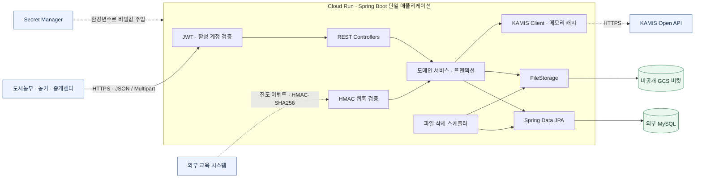
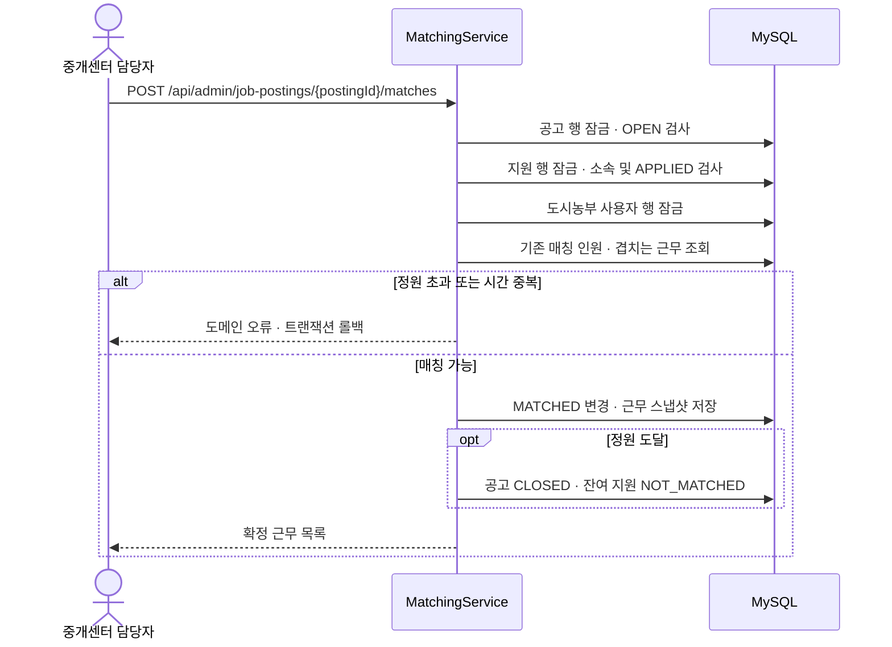
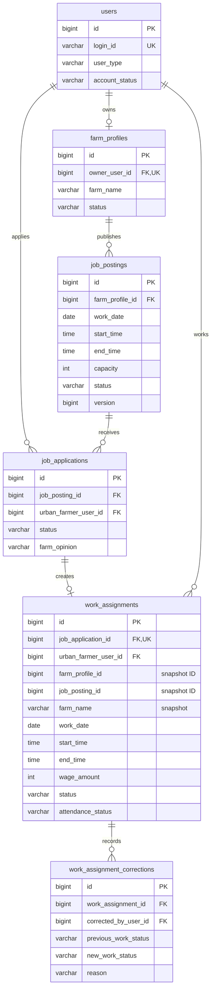
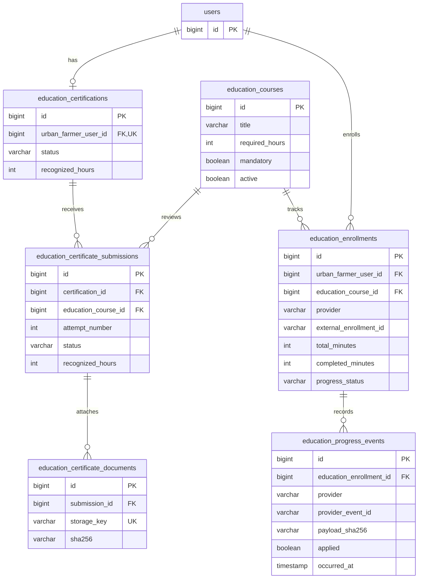
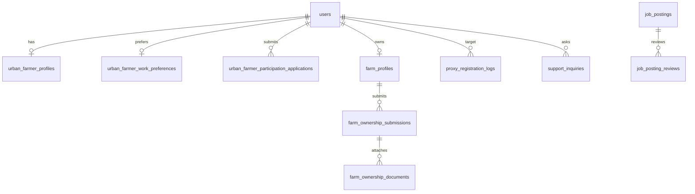
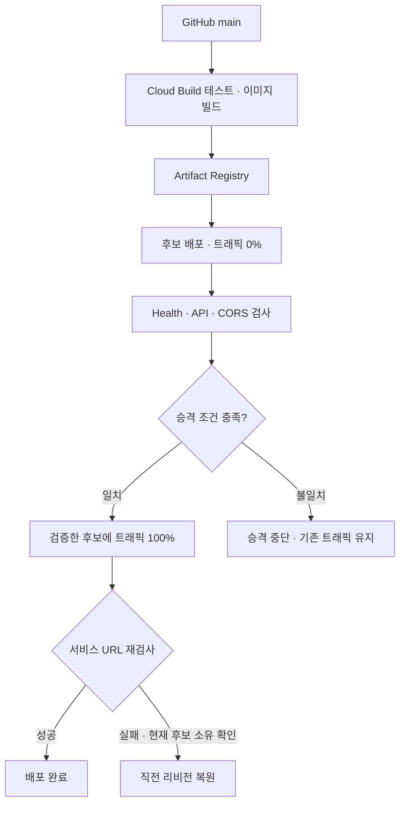

# 도시농부플러스 | CityFarmerPlus Backend

> 도시농부의 교육·지원부터 농가 모집, 중개센터 매칭, 근무 관리까지 연결하는 백엔드

`Java 17` · `Spring Boot 4.1.0` · `Spring Security` · `JPA` · `MySQL` · `Cloud Run`

> 도시농부플러스 서비스 로고 사진

도시농부플러스는 **[제13회 전국 ICT융합 AI 공모전](https://linkareer.com/activity/330182)에 출품한 4인 팀 프로젝트**입니다. 충북형 도시농부 사업을 주제로, 도시농부·농가·중개센터의 신청·심사·매칭 과정을 하나의 서비스로 연결했습니다.

| 구분 | 내용 |
|---|---|
| 팀 구성 | 디자인 1명 · 프론트엔드 1명 · 백엔드 2명, 총 4명 |
| 참여 역할 | 백엔드 개발자 2명 중 1명으로 참여, 두 개발자가 이 저장소를 공동 사용 |
| 문서 범위 | 백엔드 팀의 공동 구현 내용과 설계·검증 근거 |
| 주요 설계 | 동시 매칭 제어, 신청 데이터 일관성, 파일 삭제 재시도, 외부 이벤트 검증 |

[프로젝트 배경](#프로젝트-배경) · [구현 범위](#백엔드-구현-범위) · [협업 방식](#협업-방식) · [아키텍처](#백엔드-아키텍처) · [핵심 설계](#핵심-설계와-문제-해결) · [ERD](#데이터-모델과-erd) · [검증](#테스트와-검증) · [실행](#로컬-실행)

## 프로젝트 배경

공모전은 ICT 융합기술을 활용한 지역 문제 해결과 주민 생활 편의를 주제로 아이디어와 시제품을 모집했습니다. 도시농부플러스는 **농촌 일손 모집과 도시농부 참여 절차**를 다뤘습니다.

도시농부·농가·중개센터는 각자의 권한으로 신청·심사·매칭에 참여합니다. 백엔드에서는 교육 자격과 모집 정원을 확인하고, 확정된 근무 정보와 변경 이력을 관리하도록 구현했습니다.

| 서비스 과제 | 백엔드에서 다룬 문제 |
|---|---|
| 교육부터 지원까지 연결 | 수강 진도와 이수 승인을 구분하고 공고 지원 자격 검사 |
| 농가의 모집과 중개센터 매칭 연결 | 농가 의견과 최종 확정 권한 분리, 정원·시간 중복 검사 |
| 확정 이후의 근무 관리 | 근무 조건 스냅샷 보존, 출결 처리와 정정 이력 기록 |
| 문서 제출과 외부 데이터 사용 | 증빙 파일 접근 제어, 실패 보상, 시세 API 장애 대응 |

## 백엔드 구현 범위

도시농부는 교육 인증 후 공고에 지원하고, 농가는 지원자에게 선호 의견을 남깁니다. 중개센터는 심사 결과와 근무 조건을 확인해 매칭을 확정합니다. 백엔드는 이 과정의 **권한, 상태 전이, 데이터 일관성**을 관리합니다.

| 영역 | 구현 내용 |
|---|---|
| 인증·인가 | JWT·BCrypt, 역할·소유권 검사, 탈퇴 계정의 기존 토큰 차단 |
| 도시농부 | 프로필·근무 선호·참여 신청, 교육 이수증 제출, 공고 지원·취소 |
| 농가 | 프로필·소유 증빙, 모집 공고 관리, 지원자 의견, 출결·근무 완료 |
| 중개센터 | 참여·교육·농가·공고 심사, 최종 매칭, 출결 정정, 대리 접수·감사 이력 |
| 외부 연동 | 교육 진도 웹훅, KAMIS 시세 조회, Local/GCS/S3 파일 저장 |
| 배포 구성 | Docker, Cloud Build, Cloud Run, 마이그레이션·스모크 검사·롤백 스크립트 |

공고 문안과 작업 안내는 `RULE_BASED_V1`, 상담은 키워드 규칙으로 생성합니다. 외부 LLM은 사용하지 않습니다. 공고의 임금은 근로조건으로 제공하며 결제·정산과 알림·푸시는 구현 범위에 포함하지 않습니다.

## 협업 방식

저는 백엔드 개발자로 참여해 다른 백엔드 팀원 1명과 이 저장소에서 작업했습니다. 아래 설계와 구현은 백엔드 팀의 공동 작업을 기준으로 설명하며, 협업 내용은 API 명세와 PR 사례로 정리했습니다.

### 화면 요구사항을 API 계약으로 구체화

화면 연동에 필요한 데이터·상태·오류를 API 계약으로 정리했습니다. [공통 계약](docs/notion/00_COMMON_CONTRACT.md)에 인증, 오류 형식, 페이지네이션, CORS를 모으고, [기능별 명세](docs/notion/README.md)에 요청·응답 예시, 권한, 상태 전이와 제한 사항을 기록했습니다.

예를 들어 ‘희망 근무 조건 신청’ 화면은 프로필·근무 선호·사업 참여 신청을 함께 다룹니다. 이를 [통합 신청 API](docs/notion/04A_PARTICIPATION_FORM.md)로 제공해 한 요청에서 저장·제출하도록 구성했습니다. 기존 개별 API도 유지하고, 두 경로에서 같은 데이터를 수정할 수 있어 버전 검사와 트랜잭션을 함께 적용했습니다.

### 기능 개발과 릴리스를 PR로 구분

교육 진도 연동과 공고 목록 오류 수정은 작업 브랜치에서 `develop`으로 통합한 뒤, 릴리스 PR으로 `main`에 반영했습니다.

```text
기능 브랜치 → PR → develop → 릴리스 PR → main
```

교육 진도 연동의 [기능 PR #15](https://github.com/ParkChanWoo0321/CityFarmerPlus_BE/pull/15)에는 API·명세·테스트와 DB 마이그레이션·배포 설정을 포함했습니다. PR 본문에 테스트 결과와 마이그레이션, 비밀값 주입, 후보 리비전 검증 순서를 기록했고, [릴리스 PR #16](https://github.com/ParkChanWoo0321/CityFarmerPlus_BE/pull/16)으로 반영했습니다.

### API 오류를 재현 조건과 회귀 테스트로 남김

농가 공고 목록 API에서 `displayStatus`를 생략하면 400 오류가 발생한 사례가 있었습니다. 선택 필터가 없을 때 `null Specification`을 결합하는 경로를 수정하고, **공고가 없는 농가와 공고가 있는 농가** 모두 필터 없이 조회할 수 있는 통합 테스트를 추가했습니다.

수정은 [PR #24](https://github.com/ParkChanWoo0321/CityFarmerPlus_BE/pull/24), 릴리스는 [PR #25](https://github.com/ParkChanWoo0321/CityFarmerPlus_BE/pull/25)에 기록했습니다. 선택 필터 생략이라는 재현 조건을 테스트에 포함해 이후 변경에서도 확인할 수 있도록 했습니다.

## 백엔드 아키텍처

도메인별 패키지로 구성한 단일 Spring Boot 애플리케이션입니다. Controller는 요청·인증 정보를 받고, Service는 트랜잭션과 업무 흐름을 조합하며, Entity와 정책 클래스는 상태 전이를 검증합니다.



| 구성 | 역할 |
|---|---|
| Spring Security | JWT 검증, 역할 검사, DB의 활성 계정 상태 확인 |
| JPA · 외부 MySQL | 도메인 데이터와 변경 이력 저장, 잠금·제약조건 적용 |
| FileStorage | 환경에 따라 Local·GCS·S3 호환 구현체 선택 |
| 교육 웹훅 | 서명된 외부 진도 이벤트 수신·검증 |
| KAMIS Client | 시세 조회, 인스턴스 메모리 캐시·장애 시 이전 값 제공 |
| Secret Manager | 배포 환경의 DB·JWT 등 비밀값 주입 |

배포 구성은 외부 MySQL과 GCS를 사용합니다. 교육 시스템 연결선은 웹훅 수신 계약을 나타냅니다. `open-in-view=false`로 설정하고 서비스 계층에서 응답 DTO를 구성합니다.

[의존성](build.gradle) · [애플리케이션 설정](src/main/resources/application.properties) · [저장소 설정](src/main/java/chungbuk/cityfarmerplus/common/storage/FileStorageConfig.java)

## 핵심 설계와 문제 해결

### 1. 동시 매칭의 정원·시간 중복 제어

같은 공고에 대한 동시 요청은 정원을 초과할 수 있고, 서로 다른 공고의 요청은 같은 도시농부를 겹치는 시간에 배정할 수 있습니다.

`AdminJobPostingMatchingService`는 하나의 트랜잭션에서 **공고 → 지원 → 도시농부 사용자 행**을 잠근 뒤 정원과 기존 근무 시간을 확인합니다. 사용자 행을 공통 잠금 대상으로 두어 아직 근무 배정이 없는 경우에도 동일인의 매칭 요청을 직렬화합니다. 여러 행을 잠그는 지원·사용자 쿼리는 ID 순으로 조회합니다.



시간 중복은 `기존 시작 < 신규 종료 AND 기존 종료 > 신규 시작`으로 판정합니다. 지원의 공고·도시농부 조합과 근무 배정의 지원 ID에는 UNIQUE 제약을 두었습니다. 정원에 도달하면 공고 마감과 잔여 지원의 미선정 처리를 함께 수행합니다.

[매칭 서비스](src/main/java/chungbuk/cityfarmerplus/admin/jobposting/service/AdminJobPostingMatchingService.java) · [중복 시간 쿼리](src/main/java/chungbuk/cityfarmerplus/work/repository/WorkAssignmentRepository.java) · [잠금 순서 테스트](src/test/java/chungbuk/cityfarmerplus/admin/jobposting/service/AdminJobPostingMatchingServiceLockTest.java)

### 2. 신청 데이터의 원자적 저장과 근무 조건 보존

통합 신청서는 프로필·근무 선호·연도별 신청서를 같은 트랜잭션에서 저장합니다. 요청에 포함된 세 데이터의 예상 버전을 비교해 이전 화면에서 제출한 값이 최신 내용을 덮어쓰지 않도록 검사합니다.

매칭 시에는 농가 정보, 작업일·시간, 집결 장소, 임금, 준비물 등을 `WorkAssignment`에 스냅샷으로 저장합니다. 이후 공고가 수정되어도 확정 당시의 조건을 조회할 수 있습니다. 출결 정정은 담당자만 수행하고 이전·변경 상태, 사유와 처리자를 이력으로 남깁니다.

[통합 신청 저장](src/main/java/chungbuk/cityfarmerplus/urbanfarmer/participation/service/ParticipationFormService.java) · [근무 스냅샷](src/main/java/chungbuk/cityfarmerplus/work/entity/WorkAssignment.java) · [출결 정정](src/main/java/chungbuk/cityfarmerplus/admin/work/service/AdminWorkAssignmentService.java)

### 3. 파일 업로드와 DB 저장 사이의 실패 복구

이수증 파일을 업로드한 뒤 DB 저장이 실패하면 파일만 남을 수 있습니다. 교육 이수증 제출은 파일 저장과 DB 트랜잭션을 분리하고, 실패 시 보상 삭제를 수행합니다.

| 단계 | 처리 |
|---|---|
| 검증 | 확장자·MIME·실제 헤더·크기 검사, 저장 결과의 크기·SHA-256 대조 |
| DB 저장 | 잠금 상태에서 제출 조건을 다시 확인하고 제출 내역 저장 |
| 실패 보상 | `REQUIRES_NEW`로 삭제 작업을 기록한 뒤 즉시 삭제 시도 |
| 재시도 | 최대 100건씩 잠금 조회, 30초부터 최대 1시간까지 지수 백오프 |
| 탈퇴 처리 | DB 트랜잭션에 삭제 작업을 기록하고 커밋 이후 파일 삭제 |

다운로드도 소유자·담당자 권한을 검사합니다. 복구 범위는 삭제 작업이 DB에 기록된 이후이며, 작업 등록 전 프로세스 종료는 별도 고아 파일 정리가 필요합니다. 농가 증빙의 업로드 실패 경로는 즉시 삭제까지만 구현되어 있어 교육 이수증과 같은 재시도 정책으로 통일할 여지가 있습니다.

[교육 파일 제출](src/main/java/chungbuk/cityfarmerplus/education/service/EducationSubmissionService.java) · [보상 삭제](src/main/java/chungbuk/cityfarmerplus/common/storage/FileDeletionScheduler.java) · [재시도 워커](src/main/java/chungbuk/cityfarmerplus/common/storage/FileDeletionWorker.java)

### 4. 교육 웹훅의 위변조·중복·순서 역전 검증

외부 진도 이벤트는 `timestamp + "." + raw body`의 HMAC-SHA256 서명과 기본 ±5분의 시각 허용 범위를 검사합니다. 이미 저장된 제공자·이벤트 ID를 다시 수신하면 본문 해시를 비교합니다. 내용이 같으면 해당 수강의 현재 정보를 반환하고, 다르면 충돌 처리합니다.

과거 이벤트는 이력에 남기되 현재 진도를 덮어쓰지 않습니다. 더 최신 이벤트라도 수강 시간 감소나 완료 상태의 되돌림은 거부합니다. 현재 진도와 수신 이력을 별도 테이블에 저장하고 적용 여부를 기록합니다. 동시 중복 요청의 저장은 UNIQUE 제약으로 제한하며, 이때 발생하는 제약조건 충돌을 기존 성공 응답으로 변환하는 처리는 구현하지 않았습니다.

수강률과 교육 이수 승인은 별개입니다. 공고 지원 자격은 활성 필수 과정의 최신 이수증 심사 결과와 인정 시간으로 계산합니다.

[서명 검증](src/main/java/chungbuk/cityfarmerplus/education/progress/security/EducationProgressWebhookVerifier.java) · [이벤트 처리](src/main/java/chungbuk/cityfarmerplus/education/progress/service/EducationProgressEventService.java) · [교육 자격 계산](src/main/java/chungbuk/cityfarmerplus/education/service/EducationCertificationProgressCalculator.java)

### 5. 외부 시세 API 장애 대응

KAMIS 시세는 메모리 스냅샷으로 제공하며 연결 2초·응답 5초 제한을 적용했습니다. 정상 캐시는 1시간 유지하고, 갱신 실패 시 마지막 성공값을 수집 시점부터 최대 24시간까지 제공합니다. 이때 응답의 `stale=true`로 이전 값임을 알립니다.

`AtomicBoolean`으로 인스턴스 내 한 요청만 캐시를 갱신하게 하고, 실패 후 30초 동안 추가 호출을 제한합니다. 갱신이 진행 중이거나 실패한 상황에서 제공 가능한 캐시도 없으면 오류를 반환합니다. 여러 인스턴스 사이의 중복 갱신은 제어하지 않으므로, 확장 시 외부 API 호출량에 따라 공유 캐시나 별도 수집 작업을 검토할 수 있습니다.

[시세 서비스](src/main/java/chungbuk/cityfarmerplus/marketprice/service/MarketPriceService.java) · [캐시·동시 갱신 테스트](src/test/java/chungbuk/cityfarmerplus/marketprice/service/MarketPriceServiceTest.java)

### 6. 공고 목록의 반복 조회 줄이기

공고 목록은 `@EntityGraph`로 농가·소유자 정보를 함께 조회합니다. 사용자의 지원 상태와 공고 심사 이력은 현재 페이지의 공고 ID 목록으로 일괄 조회해 응답에 조합합니다. 검색 조건은 JPA Specification으로 구성합니다.

항목별 추가 조회를 줄이는 구조를 적용했으며 성능 개선 수치는 별도로 측정하지 않았습니다. 심사 이력이 누적되면 공고별 최신 한 건만 DB에서 조회하도록 개선할 수 있습니다.

[공고 저장소](src/main/java/chungbuk/cityfarmerplus/jobposting/repository/JobPostingRepository.java) · [공개 목록](src/main/java/chungbuk/cityfarmerplus/jobposting/service/PublicJobPostingService.java) · [심사 이력 조합](src/main/java/chungbuk/cityfarmerplus/jobposting/service/JobPostingResponseAssembler.java)

## 데이터 모델과 ERD

JPA 엔티티의 테이블명·키·연관관계를 기준으로 작성했습니다. 가독성을 위해 핵심 컬럼을 표시하고, 심사자·처리자 사용자 참조와 컬렉션 테이블 등 일부 관계는 생략했습니다.

### 모집·지원·근무



`work_assignments.farm_profile_id`와 `job_posting_id`는 스냅샷용 ID 컬럼입니다. JPA 연관관계로 선언된 FK와 구분해 표시했습니다. 지원은 공고·도시농부 조합당 한 행을 유지하며, 취소 후 재지원은 기존 지원의 상태와 스냅샷을 갱신합니다.

### 교육 심사·외부 진도



주요 복합 UNIQUE 제약은 다음과 같습니다.

| 테이블 | 유일성 기준 | 목적 |
|---|---|---|
| `job_applications` | 공고 + 도시농부 | 중복 지원 행 방지 |
| `urban_farmer_participation_applications` | 도시농부 + 사업연도 | 연도별 신청서 중복 방지 |
| `education_certificate_submissions` | 교육 인증 + 제출 회차 | 제출 이력 회차 중복 방지 |
| `education_enrollments` | 도시농부 + 과정 / 제공자 + 외부 수강 ID | 내부 수강과 외부 등록의 중복 연결 방지 |
| `education_progress_events` | 제공자 + 이벤트 ID | 이벤트 재수신 식별 |
| `farm_ownership_submissions` | 농가 + 제출 회차 | 증빙 재제출 이력 구분 |

<details>
<summary>참여 신청·농가 증빙·운영 이력의 추가 관계</summary>



- 근무 선호의 지역·요일·작업 유형은 각각 별도 컬렉션 테이블에 저장합니다.
- `job_posting_reviews`는 심사 행동·사유와 당시 제목·본문을 기록합니다.
- `proxy_registration_logs`는 대리 처리한 관리자, 대상 회원·객체, 작업 종류, 사유를 기록합니다.
- `file_deletion_tasks`는 저장 키를 기준으로 삭제 재시도 상태를 관리하는 독립 테이블입니다.

</details>

## 인증과 API 계약

- `URBAN_FARMER`, `FARM`, `CENTER_ADMIN`을 구분하고 역할·소유권·업무 상태를 검사합니다.
- JWT 검증 뒤 DB의 활성 여부와 역할을 확인해 탈퇴한 계정의 기존 토큰을 차단합니다.
- 담당자 계정은 별도 프로비저닝 키를 사용하는 내부 API로 생성합니다.
- 오류는 `code`·`message`, 페이지 목록은 `PageResponse` 형식으로 제공합니다.

[보안 설정](src/main/java/chungbuk/cityfarmerplus/auth/config/SecurityConfig.java) · [활성 계정 검증](src/main/java/chungbuk/cityfarmerplus/auth/config/ActiveAccountFilter.java) · [전체 API 명세](docs/FULL_API_SPEC.md)

## 배포와 운영

다음은 저장소에 구성한 배포 흐름입니다. Cloud Build의 배포 옵션은 기본적으로 꺼져 있으며, `_DEPLOY=true`로 실행할 때 후보 배포와 트래픽 전환을 수행합니다.



| 운영 과제 | 적용 방식 |
|---|---|
| 배포 간 충돌 | GCS 객체의 generation 조건부 생성으로 배포 잠금 |
| 오래된 빌드 승격 | 후보 검사 후 원격 `main`과 빌드 커밋 일치 확인 |
| 배포 실패 | 현재 트래픽 소유권을 확인한 뒤 직전 리비전으로 롤백 |
| 상태 점검 | `/health`에서 DB `SELECT 1`, `/health/live`에서 생존 확인 |
| 실행·비밀값 | 비루트 Docker 사용자, Secret Manager 환경변수 주입 |
| 스키마 변경 | 운영 `ddl-auto=validate`, 사전 검사 → 백업·체크섬 → SQL 적용 → 사후 검증 |

저장소의 배포 설정은 Cloud Run 동시성 5·최대 인스턴스 1, Hikari 최대 커넥션 5입니다. 운영 환경의 가용성·부하 처리량에 대한 실측 수치는 포함하지 않았습니다.

[Cloud Build](cloudbuild.yaml) · [Dockerfile](Dockerfile) · [수동 배포](gcp/deploy.sh) · [스모크 검사](gcp/smoke-public.sh) · [운영 가이드](docs/GCP_DEPLOYMENT.md)

## 테스트와 검증

2026-10-23, 코드 [3455437](https://github.com/ParkChanWoo0321/CityFarmerPlus_BE/commit/3455437abf0c2a0cb6a96ad9cbd0e6f8ce12cac8)에서 Java 17로 실행한 결과입니다.

| 검증 | 결과 |
|---|---|
| `test` | **499건 통과** · 실패 0 · 오류 0 · 스킵 0 |
| `bootJar` | **빌드 성공** |
| `mysqlIntegrationTest` | 별도 MySQL 환경이 필요한 opt-in 테스트 · 위 검증에서 미실행 |

일반 테스트는 JUnit·Mockito·Spring MVC Test와 H2 영속성 테스트를 포함합니다. 권한·소유권, 상태 전이, 버전 충돌, 파일 실패 보상, 웹훅 재전송, 시세 캐시와 동시 갱신을 검증합니다. 매칭 테스트는 잠금 순서와 저장소 계약을 확인하며, 실제 MySQL 병렬 부하 테스트를 대체하지 않습니다.

```powershell
.\gradlew.bat test bootJar --no-daemon --max-workers=1
```

<details>
<summary>테스트 보고서와 MySQL 테스트 실행</summary>

보고서는 `build/reports/tests/test/index.html`에서 확인합니다. MySQL 테스트는 엔티티와 일치하는 스키마를 준비하고 전용 테스트 DB의 `DB_URL`, `DB_USERNAME`, `DB_PASSWORD`를 환경변수로 설정해 실행합니다. 잠금과 쓰기가 발생하므로 운영 DB를 대상으로 실행하지 않습니다.

```powershell
.\gradlew.bat mysqlIntegrationTest --no-daemon --max-workers=1
```

</details>

## 로컬 실행

<details>
<summary>Java 17 · MySQL 환경에서 실행하기</summary>

Java 17과 로컬 MySQL이 필요합니다. Gradle은 저장소의 Wrapper를 사용합니다.

```powershell
git clone https://github.com/ParkChanWoo0321/CityFarmerPlus_BE.git
cd CityFarmerPlus_BE
Copy-Item .env.example .env
```

`.env`의 다음 값을 자신의 로컬 환경에 맞게 설정합니다.

| 변수 | 설정 |
|---|---|
| `DB_URL`, `DB_USERNAME`, `DB_PASSWORD` | 로컬 MySQL 연결 정보 |
| `JWT_SECRET` | 독립적으로 생성한 32바이트 이상의 난수 비밀키 |
| `JPA_DDL_AUTO` | 예제의 `update`는 로컬 개발용. 운영은 마이그레이션 후 `validate` |
| `FILE_STORAGE_TYPE` | 로컬 실행은 `local` |
| `KAMIS_API_KEY`, `KAMIS_CERT_ID` | 시세 API를 사용할 때 설정 |
| `ADMIN_PROVISIONING_KEY` | 담당자 계정 생성 기능을 사용할 때 설정 |
| `EDUCATION_PROGRESS_WEBHOOK_SECRET` | 교육 진도 연동을 사용할 때 설정 |

`JAVA_HOME`이 JDK 17을 가리키는지 확인한 뒤 실행합니다. `.env`는 Git 추적에서 제외되어 있습니다.

```powershell
.\gradlew.bat bootRun
```

다른 터미널에서 DB 연결까지 확인합니다.

```powershell
Invoke-RestMethod http://localhost:8080/health
```

</details>

## 코드 구조와 상세 문서

<details>
<summary>도메인별 패키지 구조</summary>

```text
src/main/java/chungbuk/cityfarmerplus
├── auth             # JWT, 계정, 활성 상태, 탈퇴
├── urbanfarmer      # 프로필, 근무 선호, 사업 참여
├── farm             # 농가 정보, 소유 증빙
├── education        # 과정, 이수증 심사, 진도 웹훅
├── jobposting       # 모집 공고, 검색, 심사 이력
├── application      # 공고 지원, 농가 의견
├── work             # 근무 스냅샷, 출결, 작업 안내
├── admin            # 중개센터 심사, 매칭, 정정, 대리 접수
├── marketprice      # KAMIS 연동, 캐시, 장애 대응
├── ai               # 규칙 기반 공고 문안과 상담
├── dashboard        # 사용자별 현황
├── support          # FAQ
├── common           # 저장소, 삭제 재시도, 검증, 공통 응답
└── health           # DB 연결 및 생존 확인
```

</details>

- [API 명세 인덱스](docs/API_SPEC_INDEX.md) / [기능별 명세](docs/notion/README.md)
- [교육 진도 연동 계약](docs/EDUCATION_PROGRESS_API_SPEC.md)
- [담당자 매칭 API](docs/ADMIN_JOB_POSTING_API_SPEC.md)
- [근무 정정 API](docs/ADMIN_WORK_ASSIGNMENT_API_SPEC.md)
- [GCP 배포·운영 가이드](docs/GCP_DEPLOYMENT.md)
